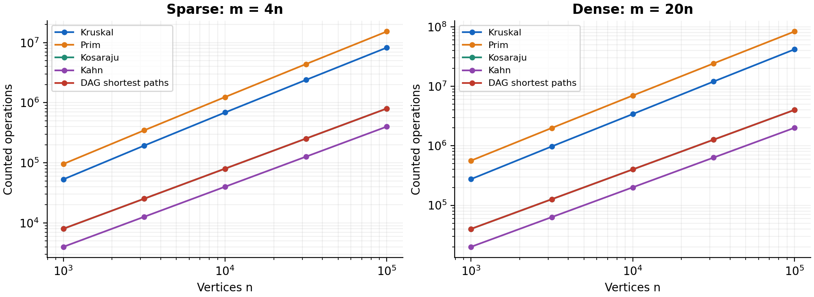
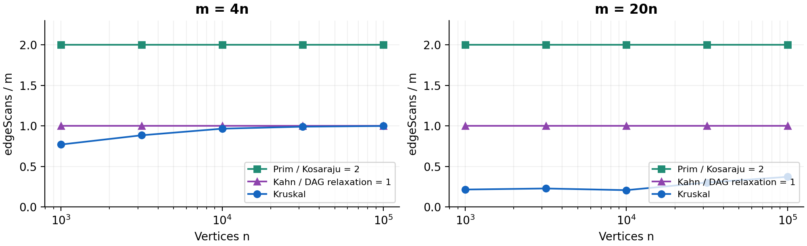
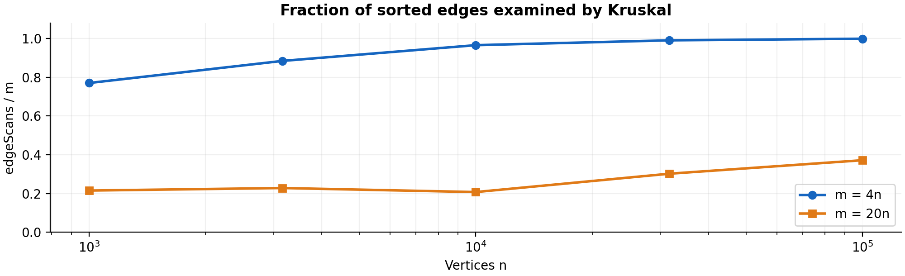

# Assignment 3 - Graphs: DSU, MST, SCC and Shortest Paths

**Bekzat Demeuov | SE-2509**  
Repository: https://github.com/bekzatdemeuov00-source/Assignment3-DAA  
Release: `v1.0`

## 1. Design, complexity, and counters

One adjacency-list Graph supports directed and undirected weighted multigraphs. Vertices are numbered 0..V-1; weights are int, while distances and total weights are long. An undirected logical edge has two adjacency entries. Four files in data/ cover a disconnected network, a directed cycle, a DAG, and self-loops/parallel edges. Invalid graph sizes, vertices, graph types, and malformed files are rejected. The MST implementations return a minimum spanning forest with C components and V-C edges, including isolated vertices.

| Operation | Time | Extra space | Justification |
|---|---|---|---|
| DSU find / union | Amortized O(alpha(V)) | O(V) for DSU; O(1) per call | Union by size plus full iterative path compression |
| Kruskal | O(V + E log E + E alpha(V)) | O(V+E) | Own stable merge sort, followed by DSU cycle checks |
| Prim, lazy edge heap | O(V + E log(E+1)) | O(V+E) | O(E) heap offers/polls; each adjacency entry scanned |
| Kosaraju | O(V+E) | O(V+E) | Two iterative DFS passes and reversed adjacency |
| Kahn | O(V+E) | O(V) | Copy stored in-degrees; process every vertex/edge once |
| DAG shortest paths | O(V+E) | O(V) | Kahn ordering plus one relaxation pass |
| Tarjan, bonus | O(V+E) | O(V) | One iterative DFS with lowlinks and active stack |

DSU's bound is amortized over a sequence; an individual find may take O(log V) before compression. The API counters verify the number of calls, not the number of internal parent-pointer steps, so they alone do not experimentally prove the alpha(V) bound.

Counters are incremented inside the algorithms. **dsuOps** is find calls plus successful unions; union performs its two finds internally. Therefore Kruskal has `dsuOps = 2*edgeScans + selectedEdges`. **comparisons** counts weight comparisons in merge sort and PriorityQueue; DAG relaxation counts distance comparisons. **maxDepth** measures explicit DFS stack depth; Tarjan records the maximum of its DFS-frame and active-stack sizes.

**edgeScans** counts traversal work: Prim scans 2E undirected adjacency entries, Kosaraju scans 2E in its two DFS passes, and Kahn / DAG relaxation / Tarjan scan E. Reversed-adjacency construction is preparation, excluded from Kosaraju's DFS counter. The shortest-path call times its internal Kahn pass too, but its edgeScans counter covers relaxation only; Kahn's scans are reported separately. These scopes satisfy the required exact identities without hiding the additional linear preparation work.

## 2. Correctness and algorithm selection

### MST: cut-property argument

A cut divides the vertices into two nonempty parts. Its lightest crossing edge is safe when the cut respects the edges already selected. To prove this, take an MST extending the selected forest and add that crossing edge. If a cycle appears, another edge on the cycle crosses the same cut. Removing that other edge preserves connectivity and cannot increase the total weight. Kruskal uses the cut around a DSU component and accepts the next sorted edge joining distinct components. Prim uses the cut between its visited tree and the remaining vertices, selecting the lightest frontier edge. Repeating safe additions gives an MST in each connected component and thus a minimum spanning forest.

### DAG shortest paths: induction

Every edge of a DAG goes forward in a topological order. Every in-degree-zero vertex starts at distance zero, equivalent to a virtual super-source with zero-weight edges to all sources. Assume all vertices preceding the current vertex already have correct distances. Every incoming path ends through a predecessor that occurs earlier in the order. Those predecessors have therefore already offered every possible final-edge candidate. The smallest candidate is the correct shortest distance, establishing the induction step. Relaxing outgoing edges propagates these correct distances, and parent pointers retain a minimizing path. Negative weights are safe because the graph has no cycles; general graphs may contain negative cycles, and Dijkstra's greedy finalization can also fail with negative edges.

| Situation | Choice | Why |
|---|---|---|
| Sparse graph, edge list | Kruskal | Sort once; compact DSU; fewer comparisons in these measurements |
| Adjacency list, frontier expansion | Prim | PriorityQueue naturally grows the visited tree |
| Very dense graph, matrix available | Consider matrix Prim, O(V^2) | Avoid sorting/heaping O(V^2) edges; not the implementation used here |
| Disconnected road network | Either MST algorithm | Both return C components and V-C forest edges |
| Directed cycles / deadlocks | Kosaraju or Tarjan | Identify complete SCC membership; Tarjan saves one DFS scan pass |
| Dependency ordering | Kahn | Valid order or explicit cycle error |
| DAG, including negative weights | DAG shortest paths | Linear time with all sources initialized |
| General weighted cyclic graph | Dijkstra / Bellman-Ford as applicable | Dijkstra needs nonnegative weights; Bellman-Ford detects negative cycles |

Both generated densities are E=cV. The assignment's "dense" label means c=20, not asymptotic E=Theta(V^2). This implementation uses lazy edge-heap Prim, so its logarithmic factor and heap storage depend on E.

## 3. Reproducibility and reference validation

Five sizes and two densities produce ten configurations, with three graph kinds per configuration. Every graph starts a fresh Random(42). Undirected generation shuffles its permutation, builds the specified random spanning tree, then adds random edges. Directed generation does not shuffle. DAG generation uses the shuffled array itself as rank. When a==b, only b is redrawn, before drawing a weight in 1..1000.

Each algorithm runs five times; the CSV stores the median time. Every run checks deterministic counters and results. The benchmark checks both MST weights, V-1 tree edges, SCC counts, topological validity, distance sums, and exact scan identities. **All ten reference triples passed**, including the largest graphs.

| V | E | MST weight | SCC count | Sum of DAG distances |
|---:|---:|---:|---:|---:|
| 1,000 | 4,000 | 147,970 | 27 | 396,274 |
| 1,000 | 20,000 | 30,363 | 1 | 252,411 |
| 3,162 | 12,648 | 468,911 | 137 | 1,271,911 |
| 3,162 | 63,240 | 97,589 | 1 | 723,157 |
| 10,000 | 40,000 | 1,486,139 | 373 | 3,941,828 |
| 10,000 | 200,000 | 309,550 | 1 | 2,381,342 |
| 31,623 | 126,492 | 4,715,515 | 1,188 | 12,551,891 |
| 31,623 | 632,460 | 968,517 | 1 | 7,376,612 |
| 100,000 | 400,000 | 15,012,094 | 3,923 | 40,096,539 |
| 100,000 | 2,000,000 | 3,056,681 | 1 | 23,512,087 |

### Counter / formula check

The complete per-graph ratios are in results/normalized.csv. At fixed density c, Kosaraju's scans/(V+E)=2c/(1+c), while Kahn and relaxation give c/(1+c), exactly constant.

<!-- measured-ratios -->
| Algorithm | m/n | Normalizer | Observed min..max |
|---|---:|---|---:|
| Kruskal | 4 | comparisons / (E log2 E) | 0.894 .. 0.933 |
| Kruskal | 20 | comparisons / (E log2 E) | 0.913 .. 0.940 |
| Prim | 4 | comparisons / (E log2 E) | 1.831 .. 1.946 |
| Prim | 20 | comparisons / (E log2 E) | 1.826 .. 1.892 |
| Kosaraju | 4 | scans / (V+E) | 1.600 .. 1.600 |
| Kosaraju | 20 | scans / (V+E) | 1.905 .. 1.905 |
| Kahn | 4 | scans / (V+E) | 0.800 .. 0.800 |
| Kahn | 20 | scans / (V+E) | 0.952 .. 0.952 |
| DAG shortest paths | 4 | scans / (V+E) | 0.800 .. 0.800 |
| DAG shortest paths | 20 | scans / (V+E) | 0.952 .. 0.952 |
<!-- /measured-ratios -->

The sorting/heap comparison ratios remain bounded across two orders of magnitude. Kruskal's DSU/E varies with its early stopping position, so comparison/(E log2 E) captures the dominant sorting work more directly. The counters support the complexity formulas; they do not count every machine instruction or allocation.

## 4. Measured growth, slopes, and elapsed time

Operations = dsuOps + edgeScans + comparisons; maxDepth is a maximum rather than additive work. Separate panels show both densities. The fitted slope is ordinary least squares on log(n), log(counter), using all five sizes at fixed density.

| Algorithm | m/n | Scan slope | Comparison slope | Total-operation slope |
|---|---:|---:|---:|---:|
| Kruskal | 4 | 1.055 | 1.105 | 1.095 |
| Kruskal | 20 | 1.119 | 1.089 | 1.090 |
| Prim | 4 | 1.000 | 1.109 | 1.102 |
| Prim | 20 | 1.000 | 1.090 | 1.085 |
| Kosaraju | 4 / 20 | 1.000 | - | 1.000 |
| Kahn | 4 / 20 | 1.000 | - | 1.000 |
| DAG shortest paths | 4 / 20 | 1.000 | 1.000 | 1.000 |

Traversals have scan slope 1.000. Kruskal's scan slope differs because the fraction examined before connectivity varies. Its E log E factor appears in **sorting comparisons**, not in scanning an already-sorted edge array. Exact fitted values are in results/slopes.csv.

The five largest-graph medians are recorded in results/results.csv alongside the machine-specific environment in results/environment.txt. Small cases showed JIT/allocation noise and non-monotonic timing. These five-run medians include algorithm allocations, with no separate warm-up; JVM version, GC, hardware, and background load affect them. Timings are illustrative, while deterministic counters provide the primary evidence. The measured environment was Windows 11, Java 26.0.2.1, with a 2 GiB maximum JVM heap; the source targets Java 17.

## 5. Scans, tradeoffs, tests, and bonus tasks

Prim and Kosaraju overlap at 2; Kahn and DAG relaxation overlap at 1. Flat ratios confirm the exact scan identities.

At n=100,000, Kruskal examines 99.917% of sparse edges and 37.179% of dense edges. It still sorts every edge: the saving affects DSU and acceptance scans only. Lazy Prim scans both adjacency directions and performs more heap comparisons in these generated cases. This does not establish a universal winner for every graph representation and distribution.

**Testing:** all 19 JUnit 5 tests passed, with zero failures, errors, or skips. Coverage includes DSU against reference partitions, 100 connected MST graphs, 50 exhaustive tiny-tree comparisons, SCC partitions against all-pairs BFS with n up to 200, 100 random negative-weight DAGs against Bellman-Ford, restored paths, invalid orders and cycles, all three required input examples, malformed input, loops/parallel edges/isolates, and SCC paths and cycles of 100,000 vertices.

**Bonus A:** iterative Tarjan uses index, lowlink, an explicit DFS-frame stack, and a separate active stack. It matches Kosaraju's full partitions in every random test and all benchmark graphs. It scans E rather than 2E DFS edges and needs no reversed graph. Ten five-run measurements are in results/bonus_results.csv.

**Bonus B:** condensation collapses SCCs and removes intra-component edges; parallel transitions keep their largest weight for critical-path analysis. Negating long weights and relaxing in topological order yields a longest component path with parent restoration. Random condensation graphs are checked for acyclicity, and their longest paths are compared against exhaustive enumeration. Critical paths identify the chain determining a schedule's earliest completion when weights encode durations. Cyclic job groups must first be resolved; this abstraction does not compute durations inside an SCC. Longest simple paths are NP-hard in general graphs, and unrestricted positive cycles can make a longest walk unbounded; a DAG avoids both problems.

## Reproduce and defend

Run `python scripts/reproduce.py` after installing scripts/requirements.txt to rebuild, run tests, check all references, and regenerate CSVs, fitted ratios, slopes, and plots. For Java-only validation, run `.\mvnw.cmd clean verify -Pbenchmark`. README.md includes all commands, package layout, GitHub link, release tag, and AI-use acknowledgement.
